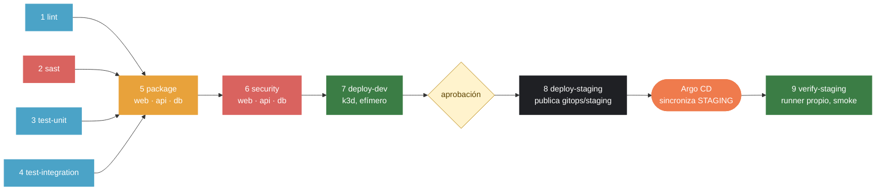

# demo-cicd: libro de visitas con pipeline CI/CD

[](https://github.com/Jesusro-del/demo-cicd/actions/workflows/ci-cd.yml)

LAB-04 del curso IF-1116, Tópicos de Tecnologías de Información, semestre 2026-II. Jesús Razo Oliva.

Un pipeline de GitHub Actions ([`.github/workflows/ci-cd.yml`](.github/workflows/ci-cd.yml)) que revisa, prueba, empaqueta, escanea y despliega el libro de visitas (web, api y db) a un ambiente DEV efímero y, con aprobación manual, a un STAGING persistente en mi Rancher Desktop. Cada run deja un resumen con las pruebas y las vulnerabilidades por severidad en su página de Actions, para que quien aprueba STAGING sepa qué está aprobando sin abrir ningún log.

## El pipeline



`lint`, `sast`, `test-unit` y `test-integration` arrancan a la vez y se juntan en `package`: no se publica ninguna imagen sin las cuatro en verde. `package` y `security` son matrices: un job por imagen. DEV y STAGING reciben **la misma imagen** `sha-<commit>` que se construyó y escaneó; nada se reconstruye.

| # | Etapa | Herramienta | Qué revisa | Si falla | Evento |
|:-:|-------|-------------|------------|----------|--------|
| 1 | `lint` | ESLint, HTMLHint, Hadolint (contenedor) | Estilo y errores del JavaScript, el HTML de la página y los tres Dockerfiles (umbral `warning`) | Job en rojo; `package` y todo lo que sigue no corren | PR y push a `main` |
| 2 | `sast` | Semgrep 1.180.0 y TruffleHog 3.99.3 (contenedores) | Patrones inseguros en código, workflows y Dockerfiles (`p/ci`, `p/dockerfile`); secretos verificados y no verificados en **todo** el historial de Git | Job en rojo; `package` no corre. El log muestra detector, archivo y commit, nunca el valor del secreto | PR y push a `main` |
| 3 | `test-unit` | Vitest y Supertest, jsdom | 11 pruebas de la API con un pool de Postgres falso y 7 de la página estática | Job en rojo, con la lista de pruebas fallidas en el resumen | PR y push a `main` |
| 4 | `test-integration` | Docker Compose y Vitest (`fetch`) | La aplicación completa dentro del runner, entrando por nginx: 7 pruebas | Job en rojo y se imprimen los logs de los contenedores | PR y push a `main` |
| 5 | `package` | Docker Buildx, GitHub Packages (GHCR) | Que las tres imágenes construyan (amd64 y arm64) y se publiquen con tag `sha-<commit>` | Job en rojo; no hay imagen que escanear ni desplegar | PR y push a `main` |
| 6 | `security` | Grype v0.121.0 (contenedor; `--fail-on high`, solo con parche) | Vulnerabilidades de cada imagen publicada; las aceptadas están en [`.grype.yaml`](.grype.yaml), una por una con su porqué y acotadas al binario | Job en rojo con la tabla de vulnerabilidades en el resumen; nada llega a DEV | PR y push a `main` |
| 7 | `deploy-dev` | k3d (k3s v1.36.4), kubectl, Kustomize y OWASP ZAP | Despliega en un clúster creado dentro del runner; espera el rollout; smoke test, las 7 pruebas de integración y un baseline scan de ZAP contra Kubernetes |
| 8 | `deploy-staging` | git y sed (en `ubuntu-latest`) | Con **aprobación manual** (environment `staging`): escribe la misma imagen `sha-<commit>` en `k8s/overlays/staging` y publica la rama `gitops/staging`. No toca el clúster: lo aplica Argo CD (GitOps) | Job en rojo; STAGING sigue como estaba | Solo push a `main` (o `workflow_dispatch` sobre `main`), después de aprobar. Si llega un despliegue más nuevo, el anterior se cancela (`concurrency`) |
| 9 | `verify-staging` | Runner propio (Windows), kubectl, Argo CD | Espera a que Argo CD aplique las imágenes nuevas, a que terminen los rollouts y a que se borren los pods viejos; corre el smoke contra `http://localhost:30080` | Job en rojo con el estado de la `Application` de Argo CD | Después de `deploy-staging` |

`main` está protegida: no se puede hacer merge si falla `lint`, `sast`, `test-unit`, `test-integration`, `package` (×3) o `security` (×3). Dependabot propone actualizaciones semanales de acciones, npm e imágenes base, con 7 días de `cooldown`.

### El resumen de cada run

En la página de cada run (pestaña *Summary*), cada job deja su parte, generada por [`scripts/resumen.mjs`](scripts/resumen.mjs):
- `test-unit` y `test-integration`: total, pasaron, fallaron y los nombres de las que fallaron.
- `security`: por imagen, cuántas vulnerabilidades con parche hay por severidad (`Critical` y `High` frenan), cuántas están aceptadas y la tabla de las que frenan (paquete, versión instalada, versión corregida).
- `deploy-dev`: la imagen desplegada y las pruebas de integración contra Kubernetes.
- `deploy-staging`: la imagen desplegada y la salida del smoke.

El seguimiento del laboratorio (enlaces a PR y runs, tiempos, decisiones) está en [`PROGRESO.md`](PROGRESO.md).

---

## La aplicación base

Lo que sigue es el README de la plantilla del curso, sin cambios salvo las secciones del laboratorio.

Aquí les dejo una aplicación completa y funcionando: el libro de visitas del LAB-02, ya contenerizado, con pruebas, con manifiestos de Kubernetes y con métricas. Lo que **no** tiene es el pipeline. Eso lo construyen ustedes siguiendo la [guía práctica de la Semana 06](https://github.com/urp-topicos-2026-2/.github-private/blob/main/semanas/S06/guia-pipeline.md), y lo extienden en el [LAB-04](https://github.com/urp-topicos-2026-2/.github-private/blob/main/semanas/S06/laboratorio/lab-04.md).

Todo lo que está aquí lo probé y funciona: lint, pruebas unitarias, pruebas de integración, Compose y los manifiestos. Si algo se pone en rojo en su pipeline, el problema está en el pipeline, y eso es justamente lo que tienen que resolver.

## Cómo usarlo

No hagan fork. Este repositorio es una **plantilla**: arriba a la derecha, **Use this template → Create a new repository**. Pónganle el nombre `demo-cicd`, en **su** cuenta y **público**. Público porque GitHub Actions y GitHub Packages son gratis sin límite para repositorios públicos, y porque el pipeline es la evidencia que yo reviso.

## Qué hay aquí

```
web/                    nginx: sirve la página y reenvía /api/ al backend
    Dockerfile          imagen sin root (nginx-unprivileged), escucha en 8080
    nginx.conf
    public/             index.html, estilos.css, libro-de-visitas.js
api/                    la API en Node.js (Express), con métricas para Prometheus en /metrics
    Dockerfile
    app.js              la aplicación, separada del arranque para poder probarla sin base de datos
    server.js           el arranque: pool de Postgres, puerto, señales
db/                     Postgres con las tablas ya incluidas
tests/
    unit/               pruebas unitarias de la API, con un pool falso (Vitest + Supertest)
    site/               pruebas del sitio estático (Vitest + jsdom)
    integration/        pruebas contra la aplicación completa, entrando por web (fetch)
scripts/
    smoke.sh            cinco comprobaciones rápidas contra un ambiente desplegado
    desplegar.sh        kubectl kustomize + reemplazo de imágenes + kubectl apply
k8s/
    base/               Deployments, Services, ConfigMap y PVC
    overlays/dev/       namespace demo-dev
    overlays/staging/   namespace demo-staging, web por NodePort 30080, dos réplicas de api
observabilidad/         Prometheus y Grafana con un dashboard RED ya armado
compose.yaml            la aplicación en su máquina, con perfil opcional de observabilidad
.devcontainer/          para que todo arranque solo en GitHub Codespaces
```

## Correrlo en su máquina

```bash
cp .env.example .env          # y cambien la contraseña
docker compose up -d --build --wait
open http://localhost:8080    # en Windows: start http://localhost:8080
```

Con observabilidad:

```bash
docker compose --profile observabilidad up -d --build --wait
open http://localhost:9090    # Prometheus
open http://localhost:3001    # Grafana, usuario admin, contraseña admin
```

## Las pruebas, una por una

```bash
npm ci && npm ci --prefix api   # una sola vez

npm run lint                    # ESLint sobre el JavaScript, HTMLHint sobre el HTML
npm run test:unit               # 9 pruebas, sin base de datos, en menos de un segundo
npm run test:site               # 6 pruebas sobre web/public
npm run test:integration        # 6 pruebas contra http://localhost:8080 (la app tiene que estar levantada)
APP_URL=http://localhost:30080 npm run test:integration   # las mismas, contra otro ambiente
bash scripts/smoke.sh http://localhost:8080
```

Los `Dockerfile` se revisan con [Hadolint](https://github.com/hadolint/hadolint):

```bash
docker run --rm -i hadolint/hadolint < api/Dockerfile
```

## La API

| Método y ruta | Qué hace | Respuesta |
|---|---|---|
| `GET /api/health` | Dice si el servicio está sano | `200` con `{"status":"ok"}`, o `503` si no puede hablar con la base de datos |
| `GET /api/mensajes` | Lista los mensajes, el más reciente primero | `200` con un arreglo JSON |
| `POST /api/mensajes` | Crea un mensaje. Recibe `{"nombre":"...","mensaje":"..."}` | `201` con el mensaje creado, o `400` si falta un campo o el mensaje pasa de 280 caracteres |
| `GET /metrics` | Métricas en formato Prometheus | Solo dentro de la red. nginx devuelve `404` si alguien la pide desde afuera |

Toda la configuración entra por variables de entorno: `PORT`, `DB_HOST`, `DB_PORT`, `DB_NAME`, `DB_USER` y `DB_PASSWORD`. En el código no hay ninguna contraseña, y así debe seguir.

## Kubernetes

Los manifiestos usan imágenes `demo-cicd-web:local`, `demo-cicd-api:local` y `demo-cicd-db:local`. El script `scripts/desplegar.sh` las cambia por las de su registro antes de aplicar:

```bash
kubectl create namespace demo-staging
kubectl -n demo-staging create secret generic db-credenciales --from-literal=DB_PASSWORD="$(openssl rand -hex 16)"
scripts/desplegar.sh k8s/overlays/staging ghcr.io/<usuario>/demo-cicd sha-<commit>
kubectl -n demo-staging rollout status deploy/web deploy/api deploy/db
open http://localhost:30080
```

El Secret `db-credenciales` se crea **en el clúster**, una sola vez. No está en el repositorio ni lo crea el pipeline de staging. Los pods llevan `imagePullSecrets: ghcr`: si sus paquetes son públicos, ese Secret no hace falta y Kubernetes lo ignora; si son privados, créenlo con un token que tenga `read:packages`.

## B3: el pipeline roto a propósito

Cuatro etapas rotas, cada una en su rama y su PR. Cada PR tiene dos commits: la rotura (run en rojo) y su reversión (run en verde). Los PR se cerraron sin merge. El minuto de detección va desde que se crea el run hasta que termina el job en rojo; las cuatro corrieron a la vez, el 28/10.

| Etapa | Qué rompí | Qué la detectó | Run en rojo | Run en verde | Minuto de detección |
|-------|-----------|----------------|-------------|--------------|:-------------------:|
| `sast` | `actions/checkout@v4` (tag mutable) en el job `lint` · [#21](https://github.com/Jesusro-del/demo-cicd/pull/21) | Semgrep, regla `github-actions-mutable-action-tag` | [40704482875](https://github.com/Jesusro-del/demo-cicd/actions/runs/40704482875) | [40705105624](https://github.com/Jesusro-del/demo-cicd/actions/runs/40705105624) | **0:24** |
| `lint` | `<html>` sin `lang` en `index.html` · [#20](https://github.com/Jesusro-del/demo-cicd/pull/20) | HTMLHint, regla `html-lang-require` | [40704478535](https://github.com/Jesusro-del/demo-cicd/actions/runs/40704478535) | [40705097076](https://github.com/Jesusro-del/demo-cicd/actions/runs/40705097076) | **0:26** |
| `test-integration` | `proxy_pass http://api:3001` en `nginx.conf` · [#22](https://github.com/Jesusro-del/demo-cicd/pull/22) | 4 de 6 pruebas: `expected 502 to be 200` | [40704490155](https://github.com/Jesusro-del/demo-cicd/actions/runs/40704490155) | [40705113679](https://github.com/Jesusro-del/demo-cicd/actions/runs/40705113679) | **1:26** |
| `security` | `FROM node:16-alpine` en `api/Dockerfile` · [#23](https://github.com/Jesusro-del/demo-cicd/pull/23) | Trivy en `api`: Alpine 3.18.3, 6 HIGH con parche | [40704495856](https://github.com/Jesusro-del/demo-cicd/actions/runs/40704495856) | [40705116777](https://github.com/Jesusro-del/demo-cicd/actions/runs/40705116777) | **2:48** |

Lo que muestra la última columna: un error de sintaxis o de configuración se detecta en menos de medio minuto, sin construir nada. El de `nginx.conf` pasa el lint y las unitarias, y solo lo ve la prueba que levanta la aplicación completa, en el minuto 1:26. El de la imagen base pasa todas las pruebas, porque la aplicación funciona igual en Node 16: solo lo frenó Trivy (hoy Grype), después de construir y publicar las tres imágenes, casi en el minuto 3. Cuanto más tarde se detecta, más minutos de pipeline se gastan antes de enterarse; y si no hubiera escaneo, ese error habría llegado a STAGING.

En cada caso se pone en rojo solo la etapa rota: lo que depende de ella queda *skipped* y la rama paralela sigue en verde (por ejemplo, con `sast` en rojo, `lint`, `test-unit` y `test-integration` pasan y `package` no corre).

## B6: pipeline más rápido

Tiempos sacados de la pestaña Actions. **Total** = desde que arrancan los primeros jobs hasta que termina `deploy-staging`, por el camino más largo y sin contar la espera de la aprobación.

- **Antes:** el primer run de `main` en verde, [40559516916](https://github.com/Jesusro-del/demo-cicd/actions/runs/40559516916).
- **Después:** [40726077089](https://github.com/Jesusro-del/demo-cicd/actions/runs/40726077089), segundo run de `main` con los cambios ([#27](https://github.com/Jesusro-del/demo-cicd/pull/27)) y la caché de Grype ya llena.

En los dos, STAGING no tenía nada que actualizar (en el "antes", los pods ya estaban listos tras un `rollout restart`; en el "después", el run repite el commit del anterior), así que `deploy-staging` es comparable.

| Job | Antes | Después | Qué cambió |
|-----|:-----:|:-------:|------------|
| lint | 16 s | 22 s | Nada; variación del runner |
| sast | 21 s | 27 s | TruffleHog en vez de Gitleaks (B2) |
| test-unit | 15 s, después de `lint` | 11 s, en paralelo | Ya no espera a `lint` |
| test-integration | 37 s, después de `test-unit` | 54 s, en paralelo | Ya no espera; imágenes con la caché de `package` (13 s). Este run fue lento: en otros, 38–47 s |
| **Primera fase** (hasta que puede arrancar `package`) | **1:14** | **0:55** | Las cuatro compuertas en paralelo; `package` necesita las cuatro |
| package (máx. de los tres) | 36 s | 24 s | Solo amd64, sin QEMU |
| security (máx. de los tres) | 17 s (Trivy) | 34 s (Grype) | Grype con caché diaria de su base (sin caché: ~100 s) |
| deploy-dev | 87 s (kind) | 73 s (k3d) | Clúster en 12 s (kind: 41 s); el rollout sube a 35 s porque k3s descarga las imágenes |
| deploy-staging | 17 s | 18 s | Checkout parcial; `concurrency` y solo desde `main` |
| **Total** | **4:02** | **3:34** | **−11,6 %** |

**No llegué al 25 %.** Qué pasó con cada pregunta del enunciado:
- **¿`test-unit` necesita a `lint`?** No. Ninguna prueba necesita a otra: corren las cuatro a la vez y `package` las espera a todas. Es la mejora más grande (−19 s). El precio: si el lint falla, las pruebas ya gastaron sus minutos.
- **¿`security` necesita esperar a los tres `package`?** Con una matriz, sí: un job de la matriz siguiente no arranca hasta que termina toda la anterior. Separarlo en tres cadenas `package-web → security-web` ahorraría unos 5 s, a cambio de seis jobs repetidos. No lo hice.
- **La caché de capas de Docker** ya la usaba `package`. No la usaba `test-integration`, que construía las tres imágenes desde cero. Ahora las construye con `bake` reusando la caché de `package`.
- **La caché de la base de vulnerabilidades** fue lo más importante para Grype: sin ella, `security` tardaba ~100 s. Aun con caché, Grype tarda el doble que Trivy, porque solo restaurar su base (482 MB) lleva 15 s. El cambio del B2 le costó 17 s al B6.
- **`deploy-dev`:** con kind, 41 s eran el clúster y 19 s el rollout. Con k3d, el clúster baja a 12 s, pero el rollout sube a 35 s, porque el nodo arranca sin imágenes. La ganancia neta es de 14 s.

**Qué haría para llegar al 25 %:** volver a Trivy en `security` (~−17 s, total ≈ 3:17, −19 %), y precargar las imágenes en el nodo de k3d mientras el clúster arranca (estimo −10 a −15 s). El ruido del runner también pesa: `test-integration` varió entre 38 y 54 s en runs iguales.

**Qué no me funcionó: el `concurrency` de STAGING.** Lo agregué con `cancel-in-progress: false`, pensando que un despliegue nuevo cancelaría al pendiente. Pasó lo contrario. El job del PR #28, esperando la aprobación, ya ocupaba el grupo, y el despliegue del PR #29 se quedó en cola detrás de él ([40727836457](https://github.com/Jesusro-del/demo-cicd/actions/runs/40727836457) y [40731484066](https://github.com/Jesusro-del/demo-cicd/actions/runs/40731484066)). Hubo que rechazar el viejo a mano. Lo cambié a `cancel-in-progress: true`: gana el despliegue más nuevo. El precio es que un despliegue que ya está aplicando cambios se corta si llega otro en esos ~40 s; el siguiente lo completa, porque `kubectl apply` es idempotente. Lo probé con dos runs seguidos sobre `main`: cuando el segundo ([40735065247](https://github.com/Jesusro-del/demo-cicd/actions/runs/40735065247)) llegó a STAGING, el primero ([40734343540](https://github.com/Jesusro-del/demo-cicd/actions/runs/40734343540)), que esperaba la aprobación, se canceló solo.

## Bitácora de decisiones

### B2: Grype en vez de Trivy, TruffleHog en vez de Gitleaks

- **Decisión:** en `security`, Grype v0.121.0 (`--fail-on high --only-fixed`, excepciones en [`.grype.yaml`](.grype.yaml) acotadas a `/usr/local/bin/gosu`). En `sast`, TruffleHog 3.99.3 sobre el historial del commit del run, con `--fail` y también los secretos no verificados. Los dos en contenedor, con versión fija y con al menos 7 días publicada (el mismo criterio que el `cooldown` de Dependabot).
- **Alternativas que evalué:**
  - *Semgrep → CodeQL*: gratis en repositorios públicos y hecho por GitHub, pero no frena por defecto (hay que leer el SARIF y fallar a mano) y pide `security-events: write`.
  - *kind → k3d*: podría crear el clúster de DEV más rápido (útil para el B6), pero hay que instalar y verificar un binario, y su rojo es menos directo.
  - *Gitleaks → TruffleHog*: TruffleHog puede **verificar** si un secreto sigue activo, pero no tiene `--redact` (Gitleaks sí): imprime el secreto en claro.
  - *Trivy → Grype*: mismo trabajo (escanear la imagen publicada), con EPSS y la marca KEV en la tabla y excepciones acotadas a un paquete; pero sin fecha de caducidad para las excepciones (Trivy tiene `exp:`).
- **Por qué elegí estas:** son sustitutos directos de lo que había, en contenedor, sin permisos nuevos, y las dos tienen un rojo claro y reproducible.
- **Qué comparé:**
  - Con `node:16-alpine`, Trivy encontró 6 HIGH (paquetes de Alpine). Grype encontró **2 CRITICAL y 25 HIGH**: 17 en el propio binario de Node, una con la marca `kev` (CVE-2023-44487, explotada activamente según CISA). Grype miró el runtime; Trivy solo los paquetes del sistema.
  - En `gosu` fue al revés: Trivy reportó 25 HIGH de la librería estándar de Go; Grype cataloga el binario (encontró su dependencia `github.com/moby/sys/user`, Medium) pero no reporta la librería estándar. Las 26 excepciones de `.grype.yaml` hoy no aplican a nada; las dejé, con su justificación y acotadas a `gosu`, por si una versión futura empieza a detectarlas.
  - Ninguna herramienta ve todo: para binarios Go, Trivy cubrió más; para el runtime de Node, Grype.
- **Fuentes consultadas:**
  - Grype: [README y configuración](https://github.com/anchore/grype#configuration) (`--fail-on`, `--only-fixed`, reglas `ignore` con `package.location`).
  - TruffleHog: [README](https://github.com/trufflesecurity/trufflehog) (fuente `git`, `--results`, `--branch`, `--fail` y su código de salida 183).
  - GitHub Actions: [`defaults.run.shell`](https://docs.github.com/en/actions/reference/workflows-and-actions/workflow-syntax#defaultsrunshell), que explica que `pipefail` solo se activa con `shell: bash` explícito.
  - [CISA KEV](https://www.cisa.gov/known-exploited-vulnerabilities-catalog) y [EPSS](https://www.first.org/epss/), para leer las columnas nuevas de Grype.
- **Cómo lo verifiqué:**
  - Verde con las dos herramientas: [PR #26, run 40715089324](https://github.com/Jesusro-del/demo-cicd/actions/runs/40715089324).
  - Rojo de TruffleHog (secreto falso de Postgres en una rama temporal): [40715235000](https://github.com/Jesusro-del/demo-cicd/actions/runs/40715235000). El log muestra detector, archivo y commit, no el valor.
  - Rojo de Grype (`node:16-alpine`): [40715101417](https://github.com/Jesusro-del/demo-cicd/actions/runs/40715101417).
  - Aislamiento: con la rama del secreto falso subida, la rama limpia pasó TruffleHog con 0 secretos ([40715241456](https://github.com/Jesusro-del/demo-cicd/actions/runs/40715241456), cancelado a propósito en la aprobación de STAGING porque venía de una rama).
- **Qué no me funcionó:**
  - *Sin `pipefail`*: TruffleHog va en una tubería con `jq` para ocultar el secreto. Sin `shell: bash`, GitHub usa `bash -e` sin `pipefail`, y si TruffleHog fallaba, `jq` terminaba bien y el paso quedaba en verde: el escáner apagado sin querer. Lo vi en el log (`shell: /usr/bin/bash -e {0}`) antes de que pasara.
  - *Un secreto en una rama bloqueaba todas*: con `fetch-depth: 0` el checkout trae todas las ramas y TruffleHog las revisaba todas. El secreto falso de la rama temporal puso en rojo también la rama limpia ([40714616225](https://github.com/Jesusro-del/demo-cicd/actions/runs/40714616225)). Ahora revisa solo el historial del commit del run (`--branch`).
  - *El resumen de Grype mentía*: contaba 3 "aceptadas" en imágenes sin `gosu`, porque `ignoredMatches` mezcla lo que descarta `--only-fixed` con lo aceptado en `.grype.yaml`. Ahora se separan por la regla que aplicó Grype.
  - *Docker local no respondía* (`timed out dialing Hyper-V socket` en Rancher Desktop), así que todo se probó en el pipeline, con ramas temporales y `workflow_dispatch`.

### Reto 1: DAST con OWASP ZAP

- **Decisión:** `zap-baseline.py` (imagen `zaproxy/zap-stable:20261016`) dentro de `deploy-dev`, contra la aplicación desplegada en k3d, con los códigos de salida por defecto: cualquier WARN o FAIL no aceptado pone el job en rojo. Corregí con cabeceras en `web/nginx.conf` las siete alertas del primer escaneo. En [`zap/reglas.conf`](zap/reglas.conf) esas siete reglas quedaron en FAIL. El informe se sube como artefacto y el resumen del run lista las alertas.
- **Alternativas que evalué:**
  - *`zaproxy/action-baseline`*: más corto de escribir, pero es otra acción que fijar, y por defecto abre un issue en el repositorio con cada escaneo, lo que pide permisos de escritura. La imagen con `docker run` no necesita ningún permiso.
  - *Full scan*: además de mirar, **ataca** (inyecciones, XSS). Encuentra más, pero tarda mucho más y llena la base de DEV con basura. Para cada push alcanza con el baseline; el full scan tendría sentido de noche o antes de una entrega.
  - *API scan*: ataca la API a partir de una definición OpenAPI, y la API no tiene una.
  - *Job aparte después de DEV*: no se puede, porque DEV vive dentro del job `deploy-dev` y muere con él.
- **Por qué elegí esta:** DEV ya está levantado en el runner; ZAP se monta como un paso más, sin otro clúster y sin permisos nuevos.
- **Fuentes consultadas:**
  - [ZAP Baseline Scan](https://www.zaproxy.org/docs/docker/baseline-scan/): opciones `-c`, `-g`, `-r`, `-J` y códigos de salida.
  - [Cabeceras de seguridad en MDN](https://developer.mozilla.org/en-US/docs/Web/HTTP/Headers): `Content-Security-Policy`, `X-Content-Type-Options`, `Permissions-Policy`, `Cross-Origin-*-Policy`.
  - [OWASP Secure Headers Project](https://owasp.org/www-project-secure-headers/).
  - [`add_header` de nginx](https://nginx.org/en/docs/http/ngx_http_headers_module.html#add_header): el parámetro `always` y la herencia entre `server` y `location`.
- **Cómo lo verifiqué:**
  - Rojo, 7 WARN: [40728141052](https://github.com/Jesusro-del/demo-cicd/actions/runs/40728141052).
  - Después de las primeras cabeceras, quedaba 1 (COEP): [40729099682](https://github.com/Jesusro-del/demo-cicd/actions/runs/40729099682).
  - Verde, 0 alertas y 67 reglas pasadas, con el informe como artefacto: [40729885668](https://github.com/Jesusro-del/demo-cicd/actions/runs/40729885668).
  - PR: [#29](https://github.com/Jesusro-del/demo-cicd/pull/29).
- **Qué no me funcionó:**
  - La primera tanda de cabeceras dejó la regla 90004 a medias. Esa regla revisa tres cabeceras (CORP, COEP y COOP) y yo solo había puesto la primera.
  - El baseline no ejecuta JavaScript, así que nunca llamó a `/api/`, y por eso no vio el `X-Powered-By: Express` de la API. Lo oculté igual con `proxy_hide_header`: el escáner no es la única fuente de verdad.
- **Cuándo una alerta es un falso positivo y cuándo es aceptar un riesgo:** un falso positivo es una alerta que no describe algo real (por ejemplo, ZAP marca como "información filtrada" un texto que no es sensible). Aceptar el riesgo es reconocer que el problema existe y decidir no arreglarlo, con un porqué. Las dos cosas van en `reglas.conf` como IGNORE, pero el comentario tiene que decir cuál de las dos es. Hoy no hay ninguna.

### Reto 6: La plataforma también es código (Terraform)

- **Decisión:** en [`terraform/`](terraform/), el ruleset de `main` y los ambientes `dev` y `staging` con el provider `integrations/github` 6.13.0 y Terraform 1.17.0, los dos con versión fija y `.terraform.lock.hcl` versionado. Como todo existía, uso bloques `import` en vez de crear. El estado queda local, fuera de Git.
- **Alternativas que evalué:**
  - *Ansible para el runner*: el otro camino del reto. Tiene más sentido en una máquina Linux; en mi Windows con Rancher Desktop, el playbook necesitaría WinRM o WSL, y el runner lo registré justamente sin servicio.
  - *`terraform import` por línea de comandos*: hace lo mismo, pero no queda en el código. Los bloques `import` sí quedan, y se revisan en el PR.
  - *Estado en Terraform Cloud o en un bucket*: es lo correcto para un equipo, pero suma una cuenta y un token. Para una persona alcanza con el estado local (ver [`terraform/README.md`](terraform/README.md)).
  - *OpenTofu*: compatible y con licencia abierta. Elegí Terraform porque es lo que nombra el reto.
- **Por qué elegí esta:** son las tres cosas que configuré a mano y las tres me dieron problemas: el ruleset hubo que corregirlo en el B2 cuando cambió el nombre de un job, y `staging` hubo que crearlo antes del primer merge para no desplegar sin aprobación. En código, esos cambios pasan por un PR.
- **Fuentes consultadas:**
  - Provider `integrations/github`: [`github_repository_ruleset`](https://registry.terraform.io/providers/integrations/github/latest/docs/resources/repository_ruleset) y [`github_repository_environment`](https://registry.terraform.io/providers/integrations/github/latest/docs/resources/repository_environment).
  - [Bloques `import`](https://developer.hashicorp.com/terraform/language/import).
  - [Backends y estado](https://developer.hashicorp.com/terraform/language/state).
- **Cómo lo verifiqué:** `terraform init`, `fmt -check` y `validate` sin errores. `terraform plan` contra el repositorio real dio `Plan: 3 to import, 0 to add, 0 to change, 0 to destroy`, a la primera, porque escribí cada campo a partir de lo que devuelve `gh api` (ruleset y ambientes). PR: [#31](https://github.com/Jesusro-del/demo-cicd/pull/31).
- **Qué no me funcionó:** nada en el `plan`. Lo que sí aprendí: el ruleset exige los checks **por nombre**, y en el B2 renombrar un job dejó `main` bloqueada. Ahora la lista de checks está en `variables.tf`: cambiar un nombre es un PR que toca el workflow y Terraform a la vez.

### Reto 4: GitOps con Argo CD

- **Decisión:** Argo CD v3.5.5 en Rancher Desktop, con una `Application` ([`k8s/argocd/staging.yaml`](k8s/argocd/staging.yaml)) que sigue `k8s/overlays/staging` en la rama **`gitops/staging`**, con sincronización automática, `prune` y `selfHeal`. `deploy-staging` ya no hace `kubectl apply`. Después de la aprobación, en `ubuntu-latest`, toma el commit del run, cambia con `sed` los tres `newTag` del overlay y publica `gitops/staging` con `GITHUB_TOKEN`. Un job nuevo, `verify-staging`, corre en el runner propio y solo **lee** el clúster: espera a que Argo CD aplique las imágenes y corre el smoke.
- **Alternativas que evalué:**
  - *Commit directo a `main` con una excepción del ruleset para la app GitHub Actions*: era lo que sugiere el enunciado y lo que intenté primero. GitHub lo rechaza en un repositorio de cuenta personal (*Actor GitHub Actions integration must be part of the ruleset source or owner organization*): solo se puede en organizaciones.
  - *Deploy key con escritura como excepción del ruleset*: sí funcionaría en `main`, pero es una credencial de larga duración en GitHub Secrets, lo que la regla 6 del curso pide evitar.
  - *PR automático con el tag nuevo*: los PR creados con `GITHUB_TOKEN` no disparan workflows, así que sus checks nunca corren y el ruleset no los deja mezclar.
  - *Un repositorio de configuración aparte*: es lo más común en GitOps, pero escribir en otro repositorio exige un token o una deploy key.
  - *`kustomize edit set image` en vez de `sed`*: es lo idiomático, pero exige otro binario (con su versión y su checksum) y reescribe el archivo entero, perdiendo los comentarios.
- **Por qué elegí esta:** la rama aparte no necesita ninguna credencial nueva ni relaja la protección de `main`. Además, `gitops/staging` siempre es "un commit de `main` más el tag de ese commit": manifiestos e imágenes de STAGING salen del mismo commit.
- **Fuentes consultadas:**
  - [Instalación de Argo CD](https://argo-cd.readthedocs.io/en/stable/getting_started/) y [sincronización automática, *self-heal* y *prune*](https://argo-cd.readthedocs.io/en/stable/user-guide/auto_sync/).
  - [Bypass en rulesets](https://docs.github.com/en/repositories/configuring-branches-and-merges-in-your-repository/managing-rulesets/creating-rulesets-for-a-repository#granting-bypass-permissions-for-your-branch-or-tag-ruleset).
  - [Eventos que dispara `GITHUB_TOKEN`](https://docs.github.com/en/actions/security-for-github-actions/security-guides/automatic-token-authentication#using-the-github_token-in-a-workflow): no dispara runs nuevos, por eso no hay bucle.
- **Cómo lo verifiqué:**
  - Al crear la `Application`, Argo CD quedó en `Synced` y `Healthy` **sin reiniciar ningún pod**: el overlay ya coincidía con el clúster (`kubectl diff` sin diferencias).
  - Primer despliegue GitOps, run [40743163411](https://github.com/Jesusro-del/demo-cicd/actions/runs/40743163411): `deploy-staging` (17 s, en `ubuntu-latest`) publicó el commit [`0d0a17d`](https://github.com/Jesusro-del/demo-cicd/commit/0d0a17d817cfda00a2956c9ff4e7ac6144503051) de `github-actions[bot]` en `gitops/staging`. Argo CD lo aplicó y `verify-staging` (68 s) corrió el smoke en verde.
  - *Self-heal*: bajé `api` a 1 réplica con `kubectl scale`. Argo CD la devolvió a 2 en 3 segundos (`OutOfSync -> Synced`).
- **Qué no me funcionó:**
  - El bypass del ruleset para GitHub Actions, por lo explicado arriba. El intento quedó registrado en Terraform: el `apply` falló al modificar el ruleset, pero ya había importado los recursos y guardó el bypass en el estado aunque GitHub no lo tenía. El siguiente `plan` quería "quitar" algo que no existía. Un `apply` posterior lo alineó. Lección: un `apply` que falla a la mitad puede dejar el estado distinto de la realidad.
  - El orden importa. Si la `Application` hubiera existido antes de que el overlay tuviera el bloque `images`, Argo CD habría desplegado `demo-cicd-web:local`, que no existe en ningún registro.
- **¿Qué gané y qué perdí?** Gané que el pipeline ya **no tiene acceso al clúster**: STAGING se puede reconstruir desde Git, y cualquier cambio manual se revierte solo. El runner propio ya no despliega: solo lee para verificar, y se podría quitar si aceptara no correr el smoke desde el pipeline. Perdí inmediatez: el cambio tarda hasta 60 s en aplicarse (no hay webhook, porque GitHub no alcanza mi laptop). Y la depuración pasa por dos lugares: si algo falla después del commit, hay que mirar Argo CD, no el log del job.

## Lo que no está aquí, a propósito

- `.github/workflows/`: el pipeline. Es el trabajo de la guía y del laboratorio
- `.github/dependabot.yml`
- Los ambientes de GitHub (`dev`, `staging`) y la protección de `main`
- La configuración de los runners, de GitLab CI, de Argo CD y de todo lo que piden los retos

## Dudas

En el [issue de entrega del LAB-04](https://github.com/urp-topicos-2026-2/.github-private/issues). Cuando pregunten, pasen el enlace al run que falló, digan en qué job y en qué paso, qué esperaban y qué pasó.

Ing. Ronald Requena Crispín
