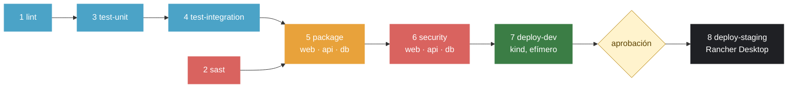

# demo-cicd: libro de visitas con pipeline CI/CD

[](https://github.com/Jesusro-del/demo-cicd/actions/workflows/ci-cd.yml)

LAB-04 del curso IF-1116, Tópicos de Tecnologías de Información, semestre 2026-II. Jesús Razo Oliva.

Un pipeline de GitHub Actions ([`.github/workflows/ci-cd.yml`](.github/workflows/ci-cd.yml)) que revisa, prueba, empaqueta, escanea y despliega el libro de visitas (web, api y db) a un ambiente DEV efímero y, con aprobación manual, a un STAGING persistente en mi Rancher Desktop. Cada run deja un resumen con las pruebas y las vulnerabilidades por severidad en su página de Actions, para que quien aprueba STAGING sepa qué está aprobando sin abrir ningún log.

## El pipeline



`lint` y `sast` arrancan a la vez. Las dos ramas se juntan en `package`: no se publica ninguna imagen sin pruebas y sin SAST. `package` y `security` son matrices: un job por imagen. DEV y STAGING reciben **la misma imagen** `sha-<commit>` que se construyó y escaneó; nada se reconstruye.

| # | Etapa | Herramienta | Qué revisa | Si falla | Evento |
|:-:|-------|-------------|------------|----------|--------|
| 1 | `lint` | ESLint, HTMLHint, Hadolint (contenedor) | Estilo y errores del JavaScript, el HTML de la página y los tres Dockerfiles (umbral `warning`) | Job en rojo; `test-unit` y todo lo que sigue no corren | PR y push a `main` |
| 2 | `sast` | Semgrep 1.180.0 y Gitleaks v8.30.1 (contenedores) | Patrones inseguros en código, workflows y Dockerfiles (`p/ci`, `p/dockerfile`); secretos en **todo** el historial de Git | Job en rojo; `package` no corre. Gitleaks no imprime el secreto (`--redact`) | PR y push a `main` |
| 3 | `test-unit` | Vitest y Supertest, jsdom | 11 pruebas de la API con un pool de Postgres falso y 7 de la página estática | Job en rojo, con la lista de pruebas fallidas en el resumen | PR y push a `main` |
| 4 | `test-integration` | Docker Compose y Vitest (`fetch`) | La aplicación completa dentro del runner, entrando por nginx: 7 pruebas | Job en rojo y se imprimen los logs de los contenedores | PR y push a `main` |
| 5 | `package` | Docker Buildx, GitHub Packages (GHCR) | Que las tres imágenes construyan (amd64 y arm64) y se publiquen con tag `sha-<commit>` | Job en rojo; no hay imagen que escanear ni desplegar | PR y push a `main` |
| 6 | `security` | Trivy (`CRITICAL,HIGH`, solo con parche) | Vulnerabilidades de cada imagen publicada; las aceptadas están en [`.trivyignore`](.trivyignore), una por una con su porqué | Job en rojo con la tabla de CVE en el resumen; nada llega a DEV | PR y push a `main` |
| 7 | `deploy-dev` | kind, kubectl y Kustomize | Despliega en un clúster creado dentro del runner; espera el rollout; smoke test y las 7 pruebas de integración contra Kubernetes | Job en rojo con el diagnóstico de los pods; STAGING no se ofrece | Solo push a `main` |
| 8 | `deploy-staging` | Runner propio (Windows), kubectl, Rancher Desktop | Con **aprobación manual** (environment `staging`): despliega la misma imagen, espera el rollout y a que se borren los pods viejos, y corre el smoke contra `http://localhost:30080` | Job en rojo; los datos de Postgres siguen en su volumen | Solo push a `main`, después de aprobar |

`main` está protegida: no se puede hacer merge si falla `lint`, `sast`, `test-unit`, `test-integration`, `package` (×3) o `security` (×3). Dependabot propone actualizaciones semanales de acciones, npm e imágenes base, con 7 días de `cooldown`.

### El resumen de cada run

En la página de cada run (pestaña *Summary*), cada job deja su parte, generada por [`scripts/resumen.mjs`](scripts/resumen.mjs):
- `test-unit` y `test-integration`: total, pasaron, fallaron y los nombres de las que fallaron.
- `security`: por imagen, cuántas `CRITICAL` y `HIGH` frenan el pipeline y la tabla de CVE (paquete, versión instalada, versión corregida).
- `deploy-dev`: la imagen desplegada y las pruebas de integración contra Kubernetes.
- `deploy-staging`: la imagen desplegada y la salida del smoke.

El seguimiento del laboratorio (enlaces a PR y runs, tiempos, decisiones) está en [`PROGRESO.md`](PROGRESO.md).

---

## La aplicación base

Lo que sigue es el README de la plantilla del curso, sin cambios salvo las secciones del laboratorio.

Aquí les dejo una aplicación completa y funcionando: el libro de visitas del LAB-02, ya contenerizado, con pruebas, con manifiestos de Kubernetes y con métricas. Lo que **no** tiene es el pipeline. Eso lo construyen ustedes siguiendo la [guía práctica de la Semana 06](https://github.com/urp-topicos-2026-2/.github-private/blob/main/semanas/S06/guia-pipeline.md), y lo extienden en el [LAB-04](https://github.com/urp-topicos-2026-2/.github-private/blob/main/semanas/S06/laboratorio/lab-04.md).

Todo lo que está aquí lo probé y funciona: lint, pruebas unitarias, pruebas de integración, Compose y los manifiestos. Si algo se pone en rojo en su pipeline, el problema está en el pipeline, y eso es justamente lo que tienen que resolver.

## Cómo usarlo

No hagan fork. Este repositorio es una **plantilla**: arriba a la derecha, **Use this template → Create a new repository**. Pónganle el nombre `demo-cicd`, en **su** cuenta y **público**. Público porque GitHub Actions y GitHub Packages son gratis sin límite para repositorios públicos, y porque el pipeline es la evidencia que yo reviso.

## Qué hay aquí

```
web/                    nginx: sirve la página y reenvía /api/ al backend
    Dockerfile          imagen sin root (nginx-unprivileged), escucha en 8080
    nginx.conf
    public/             index.html, estilos.css, libro-de-visitas.js
api/                    la API en Node.js (Express), con métricas para Prometheus en /metrics
    Dockerfile
    app.js              la aplicación, separada del arranque para poder probarla sin base de datos
    server.js           el arranque: pool de Postgres, puerto, señales
db/                     Postgres con las tablas ya incluidas
tests/
    unit/               pruebas unitarias de la API, con un pool falso (Vitest + Supertest)
    site/               pruebas del sitio estático (Vitest + jsdom)
    integration/        pruebas contra la aplicación completa, entrando por web (fetch)
scripts/
    smoke.sh            cinco comprobaciones rápidas contra un ambiente desplegado
    desplegar.sh        kubectl kustomize + reemplazo de imágenes + kubectl apply
k8s/
    base/               Deployments, Services, ConfigMap y PVC
    overlays/dev/       namespace demo-dev
    overlays/staging/   namespace demo-staging, web por NodePort 30080, dos réplicas de api
observabilidad/         Prometheus y Grafana con un dashboard RED ya armado
compose.yaml            la aplicación en su máquina, con perfil opcional de observabilidad
.devcontainer/          para que todo arranque solo en GitHub Codespaces
```

## Correrlo en su máquina

```bash
cp .env.example .env          # y cambien la contraseña
docker compose up -d --build --wait
open http://localhost:8080    # en Windows: start http://localhost:8080
```

Con observabilidad:

```bash
docker compose --profile observabilidad up -d --build --wait
open http://localhost:9090    # Prometheus
open http://localhost:3001    # Grafana, usuario admin, contraseña admin
```

## Las pruebas, una por una

```bash
npm ci && npm ci --prefix api   # una sola vez

npm run lint                    # ESLint sobre el JavaScript, HTMLHint sobre el HTML
npm run test:unit               # 9 pruebas, sin base de datos, en menos de un segundo
npm run test:site               # 6 pruebas sobre web/public
npm run test:integration        # 6 pruebas contra http://localhost:8080 (la app tiene que estar levantada)
APP_URL=http://localhost:30080 npm run test:integration   # las mismas, contra otro ambiente
bash scripts/smoke.sh http://localhost:8080
```

Los `Dockerfile` se revisan con [Hadolint](https://github.com/hadolint/hadolint):

```bash
docker run --rm -i hadolint/hadolint < api/Dockerfile
```

## La API

| Método y ruta | Qué hace | Respuesta |
|---|---|---|
| `GET /api/health` | Dice si el servicio está sano | `200` con `{"status":"ok"}`, o `503` si no puede hablar con la base de datos |
| `GET /api/mensajes` | Lista los mensajes, el más reciente primero | `200` con un arreglo JSON |
| `POST /api/mensajes` | Crea un mensaje. Recibe `{"nombre":"...","mensaje":"..."}` | `201` con el mensaje creado, o `400` si falta un campo o el mensaje pasa de 280 caracteres |
| `GET /metrics` | Métricas en formato Prometheus | Solo dentro de la red. nginx devuelve `404` si alguien la pide desde afuera |

Toda la configuración entra por variables de entorno: `PORT`, `DB_HOST`, `DB_PORT`, `DB_NAME`, `DB_USER` y `DB_PASSWORD`. En el código no hay ninguna contraseña, y así debe seguir.

## Kubernetes

Los manifiestos usan imágenes `demo-cicd-web:local`, `demo-cicd-api:local` y `demo-cicd-db:local`. El script `scripts/desplegar.sh` las cambia por las de su registro antes de aplicar:

```bash
kubectl create namespace demo-staging
kubectl -n demo-staging create secret generic db-credenciales --from-literal=DB_PASSWORD="$(openssl rand -hex 16)"
scripts/desplegar.sh k8s/overlays/staging ghcr.io/<usuario>/demo-cicd sha-<commit>
kubectl -n demo-staging rollout status deploy/web deploy/api deploy/db
open http://localhost:30080
```

El Secret `db-credenciales` se crea **en el clúster**, una sola vez. No está en el repositorio ni lo crea el pipeline de staging. Los pods llevan `imagePullSecrets: ghcr`: si sus paquetes son públicos, ese Secret no hace falta y Kubernetes lo ignora; si son privados, créenlo con un token que tenga `read:packages`.

## B3: el pipeline roto a propósito

Cuatro etapas rotas, cada una en su rama y su PR. Cada PR tiene dos commits: la rotura (run en rojo) y su reversión (run en verde). Los PR se cerraron sin merge. El minuto de detección va desde que se crea el run hasta que termina el job en rojo; las cuatro corrieron a la vez, el 28/10.

| Etapa | Qué rompí | Qué la detectó | Run en rojo | Run en verde | Minuto de detección |
|-------|-----------|----------------|-------------|--------------|:-------------------:|
| `sast` | `actions/checkout@v4` (tag mutable) en el job `lint` · [#21](https://github.com/Jesusro-del/demo-cicd/pull/21) | Semgrep, regla `github-actions-mutable-action-tag` | [40704482875](https://github.com/Jesusro-del/demo-cicd/actions/runs/40704482875) | [40705105624](https://github.com/Jesusro-del/demo-cicd/actions/runs/40705105624) | **0:24** |
| `lint` | `<html>` sin `lang` en `index.html` · [#20](https://github.com/Jesusro-del/demo-cicd/pull/20) | HTMLHint, regla `html-lang-require` | [40704478535](https://github.com/Jesusro-del/demo-cicd/actions/runs/40704478535) | [40705097076](https://github.com/Jesusro-del/demo-cicd/actions/runs/40705097076) | **0:26** |
| `test-integration` | `proxy_pass http://api:3001` en `nginx.conf` · [#22](https://github.com/Jesusro-del/demo-cicd/pull/22) | 4 de 6 pruebas: `expected 502 to be 200` | [40704490155](https://github.com/Jesusro-del/demo-cicd/actions/runs/40704490155) | [40705113679](https://github.com/Jesusro-del/demo-cicd/actions/runs/40705113679) | **1:26** |
| `security` | `FROM node:16-alpine` en `api/Dockerfile` · [#23](https://github.com/Jesusro-del/demo-cicd/pull/23) | Trivy en `api`: Alpine 3.18.3, 6 HIGH con parche | [40704495856](https://github.com/Jesusro-del/demo-cicd/actions/runs/40704495856) | [40705116777](https://github.com/Jesusro-del/demo-cicd/actions/runs/40705116777) | **2:48** |

Lo que muestra la última columna: un error de sintaxis o de configuración se detecta en menos de medio minuto, sin construir nada. El de `nginx.conf` pasa el lint y las unitarias, y solo lo ve la prueba que levanta la aplicación completa, en el minuto 1:26. El de la imagen base pasa todas las pruebas, porque la aplicación funciona igual en Node 16: solo lo frena Trivy, después de construir y publicar las tres imágenes, casi en el minuto 3. Cuanto más tarde se detecta, más minutos de pipeline se gastan antes de enterarse; y si no hubiera escaneo, ese error habría llegado a STAGING.

En cada caso se pone en rojo solo la etapa rota: lo que depende de ella queda *skipped* y la rama paralela sigue en verde (por ejemplo, con `sast` en rojo, `lint`, `test-unit` y `test-integration` pasan y `package` no corre).

## Lo que no está aquí, a propósito

- `.github/workflows/`: el pipeline. Es el trabajo de la guía y del laboratorio
- `.github/dependabot.yml`
- Los ambientes de GitHub (`dev`, `staging`) y la protección de `main`
- La configuración de los runners, de GitLab CI, de Argo CD y de todo lo que piden los retos

## Dudas

En el [issue de entrega del LAB-04](https://github.com/urp-topicos-2026-2/.github-private/issues). Cuando pregunten, pasen el enlace al run que falló, digan en qué job y en qué paso, qué esperaban y qué pasó.

Ing. Ronald Requena Crispín
